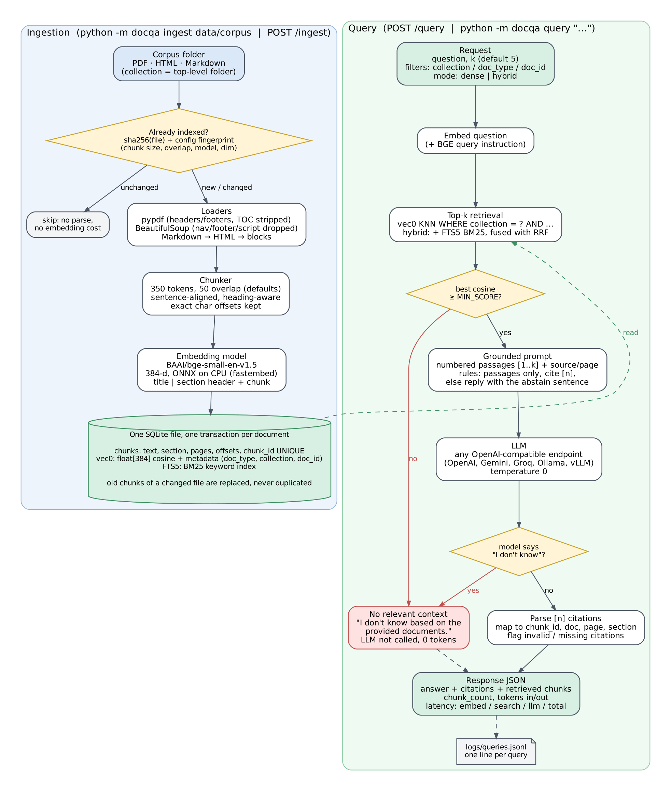

# docqa: cost-efficient RAG on SQLite + sqlite-vec

A question-answering service over a folder of PDF, HTML and Markdown files. Chunks, vectors
(`sqlite-vec`), metadata and a BM25 keyword index all live in one SQLite file, so the vector store
doesn't need a separate database server. Answers come from an OpenAI-compatible LLM, include
references to retrieved passages, and can abstain when the available evidence is insufficient.

The point of the project is to show, with numbers, when that is a credible replacement for a managed
vector database and when it stops being one.

**Latest reviewed evidence:** [corrected evaluation, controlled live experiments and remaining limits](REVIEW_FINDINGS.md). The original `results/` files remain historical baselines; new results live under `results/review-v2/`.

**Problem 2:** [LLM-as-Judge pipeline (setup, bias checks, validation, evidence)](docs/problem2/README.md).

**Submission status:** [document completion, verification and evaluation limits](SUBMISSION_COMPLETION_STATUS.md).  
**Reflection answers:** [all six answers and AI disclosures](SUBMISSION_ANSWERS.md).



## Contents

- [Submission answers](SUBMISSION_ANSWERS.md)
- [Problem 2: LLM-as-Judge](docs/problem2/README.md)
- [Why sqlite-vec](#why-sqlite-vec)
- [Quickstart](#quickstart)
- [Configuration](#configuration)
- [How it works](#how-it-works)
- [Evaluation](#evaluation)
- [Vector store at scale](#vector-store-at-scale)
- [Cost](#cost)
- [Discussion](#discussion)
- [Layout](#layout)

## Why sqlite-vec

| option | why not (for this workload) |
|---|---|
| pgvector | Good choice if Postgres is already running. Otherwise it's a server to provision, patch and back up for a few hundred MB of vectors. |
| Qdrant | Strong ANN performance, but another long-running service. Its embedded mode is Python-only and in-memory oriented. |
| ChromaDB | Easy to start with, heavier dependency tree, and less control over the on-disk format. |
| LanceDB | Nice columnar format and IVF-PQ for large indexes; more machinery than a corpus this size needs. |
| FAISS | An index, not a store: metadata, filtering, deletes and persistence would have to be built around it. |
| **sqlite-vec** | A loadable extension: a single file holding text, metadata, vectors and FTS5 together, transactional writes (which is what makes re-ingest idempotent), metadata filters inside the KNN query, nothing to operate. The cost is brute-force search, measured [below](#vector-store-at-scale). |

## Quickstart

**Prerequisites:** Python 3.10-3.13 on Linux, macOS or Windows; about 300 MB of disk for packages and
the embedding model cache; any OpenAI-compatible LLM endpoint (an OpenAI, Gemini or Groq key, or
Ollama running locally). No GPU and no database server. On macOS use a python.org or Homebrew
Python, since Apple's system Python can't load SQLite extensions.

```bash
git clone https://github.com/palaadarsh31/cost-efficient-rag.git && cd cost-efficient-rag
python -m venv .venv
source .venv/bin/activate          # Windows: .venv\Scripts\activate
pip install -r requirements-dev.txt
cp .env.example .env               # Windows: copy .env.example .env
# edit .env: LLM_BASE_URL, LLM_MODEL, LLM_API_KEY
```

**Ingest** (the embedding model, about 70 MB, downloads on first use):

```bash
python -m docqa ingest data/corpus     # CHUNK_SIZE=350 tokens, CHUNK_OVERLAP=50 by default
python -m docqa ingest data/corpus     # second run: 33 unchanged, 0 chunks written, same vector count
```

**Ask a question** on the CLI:

```bash
python -m docqa query "What is the maximum time to respond to a code review request?"
python -m docqa query "How should metric units be named?" --collection prometheus -k 3
python -m docqa retrieve "secrets injection" --doc-type pdf      # retrieval only, no LLM call
```

or over HTTP:

```bash
python -m docqa serve --port 8000      # OpenAPI docs at http://127.0.0.1:8000/docs

curl -s localhost:8000/query -H 'content-type: application/json' \
  -d '{"question": "Where does a twelve-factor app store config?", "k": 5}'
curl -s localhost:8000/query -H 'content-type: application/json' \
  -d '{"question": "When should I use the Pushgateway?", "filters": {"collection": "prometheus"}}'
curl -s localhost:8000/health
```

The response contains `answer`, `citations` (passage number, chunk id, document, page/section),
`retrieved` chunks with similarities, `chunk_count`, `usage` (prompt/completion tokens) and
`timings_ms` (embed, search, fetch, LLM, total). Every query is also appended to
`logs/queries.jsonl`.

**Tests and evaluation:**

```bash
pytest                                            # offline tests; requires dependencies in requirements-dev.txt
python -m docqa.evaluation.run --skip-answers --out results/reproduction-retrieval  # choose a fresh output directory
python -m docqa.evaluation.run --out results/reproduction-full  # includes live answer-quality calls
python -m docqa.evaluation.run --offline          # plumbing check: hash embedder + stub LLM
python scripts/bench_store.py                     # sqlite-vec at 100K / 1M vectors
python scripts/cost_model.py                      # monthly cost table
```

`make install|ingest|query|serve|test|eval|bench|cost` wraps the same commands.

## Configuration

Everything is read from environment variables (or `.env`); nothing secret is committed.

| variable | default | meaning |
|---|---|---|
| `RAG_DB_PATH` | `data/index/docqa.db` | SQLite index file |
| `CHUNK_SIZE` / `CHUNK_OVERLAP` | `350` / `50` | tokens (regex word/punctuation units) |
| `EMBED_BACKEND` | `fastembed` | `fastembed` (local ONNX), `openai` (any `/embeddings` API), `hash` (tests only) |
| `EMBED_MODEL` | `BAAI/bge-small-en-v1.5` | 384-d |
| `EMBED_QUERY_PREFIX` | BGE retrieval instruction | prepended to queries only |
| `EMBED_BASE_URL` / `EMBED_API_KEY` | | for `EMBED_BACKEND=openai` |
| `TOP_K` | `5` | chunks passed to the LLM |
| `RETRIEVAL_MODE` | `hybrid` | `hybrid` (dense + FTS5 BM25 via reciprocal rank fusion) or `dense` |
| `MIN_SCORE` | `0.5` | below this best cosine similarity the service answers "I don't know" without calling the LLM |
| `LLM_BASE_URL` / `LLM_MODEL` / `LLM_API_KEY` | OpenAI, `gpt-4o-mini` | any OpenAI-compatible chat endpoint; `OPENAI_API_KEY` is used if `LLM_API_KEY` is unset |
| `LLM_TEMPERATURE` / `LLM_MAX_TOKENS` / `LLM_TIMEOUT` | `0` / `400` / `120` | |
| `LLM_EXTRA_BODY` | | JSON merged into the request, for provider-specific switches |
| `JUDGE_BASE_URL` / `JUDGE_MODEL` / `JUDGE_API_KEY` | generation settings | LLM used by the eval harness as judge |
| `LLM_PRICE_INPUT_PER_M` / `LLM_PRICE_OUTPUT_PER_M` | | optional, adds generation cost per 1k queries to the eval report |
| `QUERY_LOG_PATH` | `logs/queries.jsonl` | `off` disables |

## How it works

**Ingestion.** Loaders turn each file into ordered blocks (headings and paragraphs). PDFs go through
`pypdf`, with running headers/footers, page numbers and table-of-contents pages removed and soft
hyphens joined. HTML goes through BeautifulSoup with `nav`, `header`, `footer`, `script` and friends
dropped. Markdown is rendered to HTML and takes the same path. Blocks keep their character offsets in
the document text and their page and section.

**Chunking.** Blocks are packed greedily into chunks of at most `CHUNK_SIZE` tokens. A block that is
too long is split at sentence boundaries, and a sentence that is still too long is split into token
windows. Overlap is carried over as whole sentences. A new section starts a new chunk once the current
one is at least half full, and a chunk never ends on a dangling heading. Each chunk is a verbatim span
of the document, which is what lets the eval label relevance from quotes.

**Embeddings.** `BAAI/bge-small-en-v1.5` (384-d, quantised ONNX through fastembed) runs on CPU.
What gets embedded is `title | section` plus the chunk text; queries get BGE's retrieval
instruction. Vectors are L2-normalised and stored as float32 in a `vec0` table with
`distance_metric=cosine`.

**Idempotent re-ingest.** A document's id is its path relative to the corpus root. Before parsing,
the file's sha256 and a fingerprint of the chunking + embedding config are compared with what's
stored. If both match, the file is skipped (no parsing, no embedding). If either changed, the
document's old chunks, vectors and FTS rows are deleted and the new ones inserted in **one
transaction**. `chunk_id` is `UNIQUE` and `(doc_id, chunk_index)` is unique too, so a duplicate can't
be written even by mistake. `--prune` removes documents whose files are gone. Re-running ingestion on
the same corpus writes 0 chunks and leaves the vector count unchanged; `tests/test_ingest.py` checks
that, plus updates, prunes, config changes and an embedder mismatch, which is refused.

**Retrieval.** `vec0` KNN with optional equality filters on `doc_type`, `collection` and `doc_id`,
evaluated inside the KNN query (they're `vec0` metadata columns). `hybrid` mode also runs an FTS5
BM25 query with the same filters and fuses both rankings with reciprocal rank fusion (k = 60).

**Answer grounding and abstention.** There are three checks:
1. If the best cosine similarity is below `MIN_SCORE`, the service returns
   `I don't know based on the provided documents.` without calling the LLM (0 tokens).
2. The prompt numbers the passages, tells the model to use only them, to cite `[n]` after every
   sentence, and to reply with that exact sentence when the passages don't contain the answer.
3. Citations are parsed and mapped back to chunks. Out-of-range numbers are reported as
   `invalid_citations`, and an answer with no citation is flagged `uncited` and logged as a warning.

The citation checks confirm that passage numbers are valid, not that every claim is supported.
The evaluation separately measures abstention on five unanswerable questions (including two near
misses), answer faithfulness, and citation precision.

## Evaluation

`data/eval/questions.jsonl` has **30 fixed questions**: 25 answerable ones spread over all four
collections and all three formats, and 5 that the corpus can't answer. Two of those are near misses:
the Pushgateway is covered but not its port, and code review is covered but not reviewer limits.
Each answerable question has a short gold answer and the **verbatim evidence sentence(s)** it relies
on.

- **Relevant chunk:** a chunk that contains at least 50% of a gold evidence quote's characters, found
  through the chunk's stored offsets. Because labels come from quotes rather than chunk ids, the same
  question set works for every chunking config in the ablation.
- **Retrieval:** Hit@k, Recall@k (over evidence facts, so two overlapping chunks holding the same
  sentence don't double count), MRR, nDCG@k (binary gains; the ideal ranking uses every relevant
  chunk in the index), Precision@k, and rank-weighted context precision. These are reported at
  k = 1, 3, 5 and 10, with 95% bootstrap confidence intervals at k = 5. Metric code is unit-tested
  against hand-computed values.
- **Answers:** an LLM judge scores faithfulness (claims split out and checked against the retrieved
  passages, score = supported / total), answer relevance (1-5 scale) and correctness against the gold
  answer. EM and token F1 use SQuAD-style normalisation (punctuation replaced with spaces, citations stripped). The report also
  covers abstention accuracy, citation validity and gold-evidence citation precision. This precision checks labeled-evidence overlap, not claim-to-citation entailment. Every judge prompt and raw
  reply is stored in `results/answers.jsonl`, and malformed judge JSON gets one retry and is otherwise
  counted as a parse failure.
- **Latency:** retrieval p50/p95 (each question repeated, warm) split into embed / search / fetch, plus
  end-to-end p50/p95 including the LLM.
- **Ablation:** chunk size/overlap of 128/16, 256/32, 350/0, 350/50, 512/64 and 800/100, each scored
  for dense and hybrid retrieval.

Results land in [`results/RESULTS.md`](results/RESULTS.md) and `results/summary.json`.

### Results of the committed run

`BAAI/bge-small-en-v1.5` embeddings, Claude Haiku 5.5 generating, Claude Sonnet 5.5 judging, a 2 vCPU
Xeon with 7.8 GB RAM, 274 chunks, k = 5. Full tables, CIs and per-question rows are in `results/`.

| retrieval @5 (25 questions) | Hit / Recall | MRR | nDCG | context precision | P@5 |
|---|---|---|---|---|---|
| dense | 0.96 | 0.75 | 0.80 | 0.74 | 0.21 |
| **hybrid (default)** | **1.00** | **0.87** | **0.90** | **0.86** | 0.22 |

| answers | value |
|---|---|
| faithfulness (claims supported by the retrieved passages) | 0.98 |
| answer relevance | 0.98 |
| correctness vs gold (LLM judge) | 1.00 (25 / 25 correct) |
| exact match / token F1 / contains gold | 0.00 / 0.27 / 0.72 |
| unanswerable questions declined | 5 / 5 (1 by the similarity gate, 4 by the model) |
| answerable questions wrongly declined | 0 / 25 |
| answers with a valid citation / cited-chunk precision | 25 / 25 / 0.79 |

| latency | p50 | p95 |
|---|---|---|
| retrieval, hybrid (embed + search + fetch) | 10.6 ms | 13.4 ms |
| end to end, including the LLM | 929 ms | 1,795 ms |

The dense-only run of the same harness is in `results/dense/`. Terminal output of one query and of
a re-ingest is in `results/terminal/` (rendered in `docs/evidence/`).

Exact match is 0 because the model answers in full sentences ("One business day is the maximum
time…") while gold answers are short spans. Token F1 and the containment check are the useful
lexical signals here. Generation averaged 2,606 prompt + 97 completion tokens, which is
$0.31 per 1,000 actual generation calls at Haiku 5.5's $0.10 / $0.50 per million tokens, or about $0.30 per 1,000 user queries including similarity-gated requests.

## Vector store at scale

`scripts/bench_store.py` uses synthetic clustered 384-d unit vectors, k = 5, 100 queries, on a
2 vCPU Xeon @ 2.8 GHz with sqlite-vec 0.1.9 (full numbers in
[`results/bench_store.json`](results/bench_store.json)):

| vectors | float32 p50 / p95 | float32 + filter (10%) p50 | int8 p50 (recall@5) | binary + re-score p50 / p95 (recall@5) | float32 file | binary index |
|---|---|---|---|---|---|---|
| 100,000 | 87 / 144 ms | 44 ms | 57 ms (0.970) | 14 / 23 ms (0.998) | 158 MB | 5 MB |
| 1,000,000 | 917 / 1134 ms | 483 ms | 604 ms (0.956) | 147 / 221 ms (1.000) | 1579 MB | 48 MB |

Brute-force float32 cost grows linearly with the vector count, which is the main limitation of this
design. Binary quantisation with exact re-scoring of 100 candidates keeps recall@5 close to exact
search at a fraction of the scan cost. Recall on synthetic data is only indicative, though: real
embeddings usually quantise better than isotropic noise, and should be re-measured before switching.

## Cost

| vectors | sqlite-vec self-hosted | Pinecone serverless (Standard) | Pinecone pods (legacy) | notes |
|---|---|---|---|---|
| 100,000 | $14 (t4g.small, 20 GB gp3, db 0.6 GB) | $50 (usage $1: storage $0.10, reads $0.50, writes $0.13; 0.31 RU/query) | $81 (1x s1) / $81 (1x p1) | float32 brute force; measured: float32 p50 87 ms, binary+rescore p50 14 ms (recall@5 1.00) |
| 1,000,000 | $26 (t4g.medium, 20 GB gp3, db 6.1 GB) | $50 (usage $7: storage $1.04, reads $5.02, writes $1.26; 3.14 RU/query) | $81 (1x s1) / $162 (2x p1) | binary + float32 re-score; measured: float32 p50 917 ms, binary+rescore p50 147 ms (recall@5 1.00) |
| 10,000,000 | $221 (c7g.2xlarge, 106 GB gp3, db 61.0 GB) | $73 (usage $73: storage $10.36, reads $50.22, writes $12.56; 31.39 RU/query) | $243 (3x s1) / $891 (11x p1) | binary + re-score, 8 shards in parallel; extrapolated (linear from 1,000,000): binary scan ~1420 ms single-threaded, ~178 ms per query across 8 shards |

Sensitivity at 10M vectors (Pinecone serverless reads scale with namespace size x queries):

| queries / month | Pinecone serverless | sqlite-vec self-hosted |
|---|---|---|
| 10,000 | $50 | $221 (fixed) |
| 100,000 | $73 | $221 (fixed) |
| 1,000,000 | $525 | $221 (fixed) |
| 5,000,000 | $2534 | $221 (fixed) |

Assumptions: 384-d vectors with the chunk text stored alongside, 100K queries a month ("lightly
queried"), 10% of chunks re-upserted monthly, AWS us-east-1 on-demand prices. Pinecone pod prices and
the Standard plan's $50 minimum come from pinecone.io (pods are legacy and closed to new sign-ups since
Aug 2025). The serverless unit rates are the widely reported $0.33/GB-month, $16/M read units and
$4/M write units, since the official calculator isn't machine-readable. Read units are metered at
1 RU per GB of namespace per query (Pinecone docs). Everything is a parameter in
`scripts/cost_model.py`.

The store is not the only bill. Generation measured at about 2,600 prompt tokens per answer costs
$0.31 per 1,000 actual generation calls on Claude Haiku 5.5, or about $30/month at 100K user queries under the measured 29/30 call rate. That's the same order
as the whole self-hosted store at 100K-1M vectors. Past that point, prompt size (k and chunk size)
is a bigger cost lever than the vector database.

## Discussion

**Trade-offs accepted.**
- Brute-force search is exact, but it costs O(n) per query: 87 ms at 100K vectors and about 917 ms at 1M on 2 vCPUs.
- One writer at a time (SQLite), which is fine for batch ingestion and not for heavy concurrent writes.
- No replication or high availability beyond restoring the file from backup.
- The contentful FTS5 table stores chunk text twice, about 30% of the file. External-content FTS5 would remove that.
- The embedding model is small: 384 dimensions are cheap to store and search, but it trades away some retrieval quality compared with larger models.

**When I would switch back to a managed database.**
- Past roughly 5-10M vectors with interactive latency targets. Brute force then needs sharding across cores or a different index, and at low query volume a serverless managed index is cheaper than the 8-vCPU box that brute force would need (see the sensitivity table in `results/COST.md`).
- When I need multi-writer ingestion, replicas or HA.
- When the team can't own backups and upgrades.

At high query volume the comparison flips back, because serverless read cost scales with namespace
size × queries. At that point self-hosted Qdrant or pgvector with HNSW is the better step.

**Was retrieval or generation the weak link?** Retrieval, until hybrid search was switched on.
- **Dense only (`results/dense/`).** Every answer whose evidence was retrieved was judged correct (24 / 24).
  The one answer that was only partly right, q21 (how secrets should be injected), was a retrieval
  miss: the evidence sentence wasn't in the top 5. The model still answered faithfully from what it
  had, an adjacent passage about external secret stores. Dense search also put the evidence at
  rank 2-4 instead of 1 for 9 other questions (MRR 0.75).
- **Hybrid (BM25 from the same SQLite file, fused with RRF; `results/`).** It finds the evidence for all 25 questions
  and lifts MRR to 0.87 for about 1 ms more per query, which is why it became the default.
- **q24 exposed an evaluator information mismatch.** Its saved answer distinguishes the supply-chain paper from the security whitepaper, and its cited source IDs match. The historical faithfulness judge received passage text without titles/paths and scored 0.5. Fresh paired trials gave text-only 0.0 and source-inclusive 1.0 in all four repetitions; this does not retroactively change the baseline score. Gold-evidence citation precision of 0.79 measures overlap with labels for the requested fact; it cannot establish that other cited claims are unsupported.
- **Abstention held.** All 5 unanswerable questions were declined and no answerable one was. The two
  near misses scored 0.67 and 0.72 cosine, inside the answerable range (≥ 0.68), so no similarity
  threshold could have caught them. The prompt-level "I don't know" did.

### Controlled review experiments

Generation and faithfulness judging now share `docqa/passages.py`. Each passage retains its citation ID, chunk ID, document path, title, section, page range and text. New answer-evaluation rows retain the actual generation prompt/settings and every judge attempt. Empty or truncated responses are failures; a refusal followed by a factual guess is not erased as a successful abstention.

```powershell
python -m docqa.evaluation.experiments --mode q24 --out results/replay-q24 --prompt-for-key
python -m docqa.evaluation.experiments --mode order --out results/replay-order --prompt-for-key
python -m docqa.evaluation.experiments --mode adversarial --out results/replay-adversarial --prompt-for-key
```

These commands default to native Anthropic, Sonnet 5.5 judging and Haiku 5.5 generating; `JUDGE_*` and `GENERATOR_*` settings can override them. Choose fresh output directories. The order experiment freezes six saved answers, uses four original-order runs, one reversal and four unique seeded shuffles per answer, and interleaves the trials. The measured run found 0/30 score disagreements for reordered comparisons and 0/18 for unchanged controls. All six answers scored fully supported, so this small ceiling-limited result cannot rule out order sensitivity on harder cases.

`data/eval/adversarial_context.json` specifies 16 cases in eight clean/modified pairs before model execution. It includes related text missing the fact, false premises, distractors and injected instructions, with answerable controls. The legacy and hardened prompts each produced 14 correct answers and two correct refusals, with zero unsupported answers, incorrect refusals or attack successes. There is no measured hardening benefit on this diagnostic suite. Supplied contexts isolate generation behavior; they do not measure retrieval attack success. The judge and generator are from the same family, and outcomes are not independently human-labeled.

The fresh real-embedding retrieval run reproduces Recall@5=1.00 and MRR@5=0.868. The default 350/50 chunks have 0/274 truncated embedding inputs (maximum 463 model tokens, limit 512). Larger 512/64 and 800/100 settings truncate 33/195 and 83/135 inputs respectively; those ablations mix chunk-size and embedding-truncation effects. Chunker version 2 fixes budget overflows at smaller settings; the default 274 content IDs remain unchanged. Fresh evidence, raw trials and limitations are in `results/review-v2/`.

## Layout

```
docqa/
  loaders.py      PDF / HTML / Markdown -> blocks with offsets
  chunking.py     token-bounded, sentence-aligned chunks
  embeddings.py   fastembed, OpenAI-compatible and hash embedders
  store.py        SQLite schema: chunks, vec0 vectors, FTS5
  ingest.py       idempotent ingestion
  retrieval.py    dense / hybrid retrieval with metadata filters
  llm.py          OpenAI-compatible chat client (usage, retries)
  qa.py           prompt, abstention, citations, query log
  api.py, cli.py  HTTP API and command line
  evaluation/     labels, metrics, LLM judge, harness, report
scripts/          corpus build, store benchmark, cost model
data/corpus/      33 documents (see data/CORPUS_SOURCES.md for sources and licenses)
data/eval/        questions.jsonl
results/          evaluation, benchmark and cost outputs
tests/            pytest suite
```
