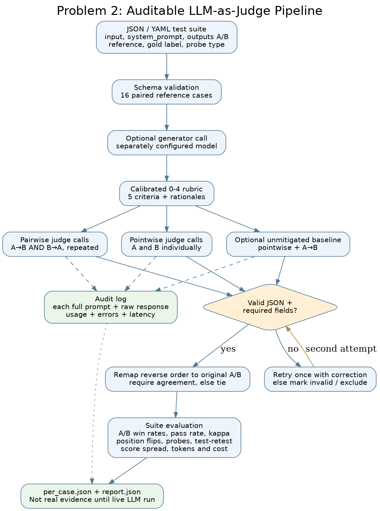

# Problem 2 — LLM-as-Judge Evaluation Pipeline

A runnable experiment to compare answer A against answer B, with a **native Anthropic** or **OpenAI-compatible** judge API. This module is independent of the `sqlite-vec` RAG dependencies. The fixed suite in `judgepipe/data/suite.json` contains **16 paired examples**, including **three padded responses** and **five confidently-wrong responses**. Expected labels are reference-derived; they are **not** claimed to be independent blinded human judgments.

The reviewed implementation uses protocol `equal-source-information-v2`. See [the review findings](../../REVIEW_FINDINGS.md) and `results/review-v2/`. Historical artifacts in `results/problem2/live/` remain unchanged. Their baseline pointwise prompts omitted context/system instructions/criteria, so the historical score-spread comparison cannot isolate calibration effects.


## What is implemented

- JSON or YAML suite ingestion, with input validation and duplicate-ID checks.
- Pointwise scoring on five explicit, weighted **0–4** criteria: correctness (30%), faithfulness (25%), completeness (20%), instruction-following (15%), tone/safety (10%). Weighted overall scores are recomputed from parsed sub-scores; the judge cannot choose its own overall.
- Pairwise comparison of two answers, scored in **both A/B and B/A orders**, mapping reversed outputs back to canonical candidate IDs. Disagreement becomes **tie**, not an unjustified win. Default two repeats allow a test-retest consistency check.
- JSON extraction from prose or Markdown fences, trailing-comma recovery, schema validation, and one correction retry; invalid verdicts are flagged, never counted as passing.
- Auditable per-request prompts, raw responses, token usage and latency in `audit.jsonl`; per-case details in `per_case.json`; aggregated metrics in `report.json`.
- Optional simpler-prompt baseline using both answer orders. Reports baseline vs rubric/order-controls for position flips, padded-answer wins, confidently wrong-answer wins, and score clustering. **A forced tie is a decision-policy safety measure, not evidence that the underlying model stopped being biased.**
- Gold/reference-label agreement and Cohen's kappa; 0–4 rubric anchors, no-length-reward instruction and adversarial probes.
- Optional generator client with separate `GENERATOR_*` configuration and a `--generate-missing` flag. It only generates cases with empty `model_output`; supplied candidates are **curated fixtures**, not proven outputs of the configured model.
- A/B summary with pass rates, mean scores, wins, ties, declared winner, and a caution that the winner rule is descriptive rather than significance-tested.

## Network and API setup — no ChatGPT connector needed

Claude API requests come directly from your Python program to `https://api.anthropic.com`.
You do **not** need to enable or grant permission to a ChatGPT connector. The original
execution environment failed DNS resolution before connecting to Anthropic; **that error
does not establish whether an API key is valid**.

Before entering any key, check connectivity **on the Windows computer where you will run
the evaluation**:

```powershell
py scripts/check_anthropic_connection.py
```

The check uses Python's standard library, sends **no key**, and tells you which stage
failed (DNS, TCP/TLS, or HTTP). Even an HTTP error response from Anthropic can confirm
that the website is reachable; the check **cannot** validate authentication, billing,
model availability, or rate limits. If DNS fails on your computer, check its internet
connection, DNS server, VPN, firewall, or corporate proxy. If it passes, use the
`--prompt-for-key` live-run command below.

Because an older Anthropic key was pasted into a chat, **revoke/rotate it** before a
live run. Never paste the replacement into chat or include it in submitted files.

## Run on Windows (PowerShell)

From the project root:

```powershell
py -m venv .venv
.\.venv\Scripts\Activate.ps1
py -m pip install pytest pyyaml
py -m judgepipe validate --suite judgepipe/data/suite.json
py -m pytest -q tests/test_judgepipe.py
py scripts/problem2_smoke.py
```

The commands above **do not use any API key**. The smoke test uses a deterministic scripted *test double*. Its numbers are NOT empirical LLM results and must not be cited as such.

To use **Claude as judge** with the key securely entered at the prompt (never stored in `.env`), set only these non-secret values for the current PowerShell session:

```powershell
$env:JUDGE_PROVIDER = 'anthropic'
$env:JUDGE_MODEL = '<an available Claude model ID>'
$env:GENERATOR_MODEL = 'reference-written'
py -m judgepipe run --suite judgepipe/data/suite.json --out results/problem2/live --max-cases 2 --repeats 2 --include-baseline --allow-same-family --prompt-for-key
```

Replace the model placeholder with an actual model ID enabled for your Anthropic account. **Use a newly rotated API key, not one previously pasted into chat.** The interactive prompt hides the key; no secret is written to a project file. The `reference-written` generator label avoids falsely attributing the provided fixture answers to GPT or any particular generator. `--allow-same-family` is needed because this fixture label has no known model family; the report explicitly flags that family independence is unverified for prewritten answers.

If the two-case pilot completes and the costs and verdicts look reasonable, run the complete suite:

```powershell
py -m judgepipe run --suite judgepipe/data/suite.json --out results/problem2/live --repeats 2 --include-baseline --allow-same-family --prompt-for-key
```

The full 16-pair run performs at least **16 × (2 pointwise + 2 baseline pair + 1 baseline pointwise + 4 order-swapped pairwise) = 144** judge calls when retries are not required, which may incur meaningful API charges. With `--include-baseline` disabled it performs at least 96 judge calls. You can also use `--max-cases` for a smaller experiment. Prices are not assumed: use `JUDGE_INPUT_USD_PER_M` and `JUDGE_OUTPUT_USD_PER_M` if you know your model's published rates, otherwise cost is marked as unknown rather than free.

API keys can alternatively be provided using an environment variable such as `ANTHROPIC_API_KEY`, but never commit it. Do not put it in CLI arguments, screenshots or the submitted ZIP. The private live `audit.jsonl` contains *full prompts and answers*; check it for sensitive content before sharing it.

## Interpretation and evidence fields

| Assignment item | Implementation / reproducible evidence |
|---|---|
| Suite → structured verdict | `judgepipe/cli.py`, `schema.py`, `parsing.py`, `runner.py`; `per_case.json` |
| Rubric, explanations, overall score | `judgepipe/rubric.py`; per-case pointwise / pairwise verdicts |
| A/B comparison and winner | `report.json` → `pointwise`, `comparison` |
| Prompt/response logging, tokens and model config | `audit.jsonl`, `report.json` → `audit` |
| Position order check | `per_case.json` → `pairwise_repeat_1.AB`, `.BA`; `report.json` → `bias` order disagreement rates |
| Length and sycophancy probes | `judgepipe/data/suite.json` `probe` labels; `report.json` → `bias` padded/confidently-wrong win rates |
| Self-enhancement risk | `JUDGE_MODEL` and `GENERATOR_MODEL` recorded separately; **not validated** without provenance of generated candidates and appropriate model runs |
| Score clustering | `report.json` → `bias` score spread / upper-end clustering; anchors in `rubric.py` |
| Judge validation | `report.json` → `comparison.agreement_with_gold`, `cohens_kappa`, `bias.test_retest_decision_agreement` |
| Adversarial verdict evidence | `per_case.json` corresponding to `probe=padded` or `probe=confidently_wrong` |

### Important limitations

1. A complete live `claude-sonnet-5-5` report is supplied in `results/problem2/live/`. It records 16/16 cases, 173 judge requests across the primary and targeted repair runs, zero API failures and zero unresolved verdicts. The untouched primary outputs and consolidation provenance are preserved beside the final files.
2. Input pairs and expected winners are reference-derived fixtures. Gold-label agreement measures judge performance *on these examples*, not general real-world performance. A stronger validation should add independent blind human labels.
3. The order-consensus rule suppresses position-sensitive *decisive outcomes* by assigning a tie on disagreement. It does not change the underlying model's propensity to flip.
4. Generator family cannot be inferred from prewritten answers. A different configured judge family mitigates self-enhancement **only when the real generator's identity is known and differs**.
5. Recorded judge usage is 134,942 input and 77,276 output tokens. At Anthropic's published Claude Sonnet 5.5 list rates ($2/M input and $10/M output, checked 18 October 2026), the estimated cost is $1.042644 USD. Taxes, credits and any unrecorded cache adjustments are excluded.
6. As stated in the provided assignment template, the mandatory personal reflection sections must be **written by the candidate without AI assistance**.

### Review corrections and stronger controls

Fresh baseline and controlled prompts receive the same input, reference, source context, generator instructions and criteria. The difference is scoring/rubric instructions. Raw disagreement is now reported across all repeated order swaps, alongside same-order repeat variability; agreement after a tie policy is reported separately. Every requested A, B, baseline and repeated verdict must validate before a run can be marked complete. Optional generation receives context/criteria and has its own usage totals. Empty or non-final completions are rejected, and the final code records stop reasons and raw provider usage.

`judgepipe/data/suite_balanced.json` is a deterministic orientation check derived from the original suite: seven A, seven B and two tie reference labels. Its JSON includes source-suite hash and swap provenance. Swapped A/B slots cannot be interpreted as stable system configurations; its purpose is judge validation. The original suite deliberately places the stronger candidate in A and therefore cannot alone rule out an A-preferring shortcut.

```powershell
$env:JUDGE_PROVIDER = 'anthropic'
$env:JUDGE_MODEL = 'claude-sonnet-5-5'
$env:GENERATOR_MODEL = 'reference-written'
python -m judgepipe run --suite judgepipe/data/suite_balanced.json --out results/reproduction-balanced --repeats 2 --include-baseline --allow-same-family --prompt-for-key
```

Choose a fresh output directory. The separate `docqa.evaluation.experiments` passage-order experiment tests fixed-answer judge sensitivity, while the paired context-adversarial experiment tests generation behavior. Neither should be described as the other. Cross-family self-enhancement remains unmeasured with reference-written fixtures; the generation robustness experiment also uses Anthropic for both generation and outcome judging.

## Files

- `judgepipe/` — schema, rubric, parsing, LLM client adapters, runner, and CLI.
- `judgepipe/data/suite.json` — 16 reference-labeled A/B cases.
- `tests/test_judgepipe.py` — tests covering order canonicalization, invalid verdicts, retries, suite validation, synthetic bias and native Anthropic request formatting.
- `scripts/problem2_smoke.py` — deliberately biased offline test double, never a live-judge evaluation.
- `scripts/check_anthropic_connection.py` — safe, key-free Windows/network connectivity diagnostic.
- `results/problem2/offline_smoke/` — labeled plumbing evidence only.
- `results/problem2/live/` — consolidated genuine Claude report, per-case data, measured tables and evidence PNGs.
- `results/problem2/live-baseline-repair/` — targeted live baseline repair with its own audit trail.
- `docs/problem2/architecture.png` — architecture showing the comparison and fallback paths.

## Fill the measured tables after a live run

After `results/problem2/live/report.json` exists from a **real** Anthropic run, generate the exact numbers needed for section 2.3 of the employer's template:

```powershell
py scripts/problem2_submission_summary.py --report results/problem2/live/report.json
```

This creates `results/problem2/live/submission_tables.md`. It deliberately rejects offline test-double reports and **does not write the prohibited AI-assisted personal reflections**.
